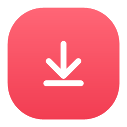
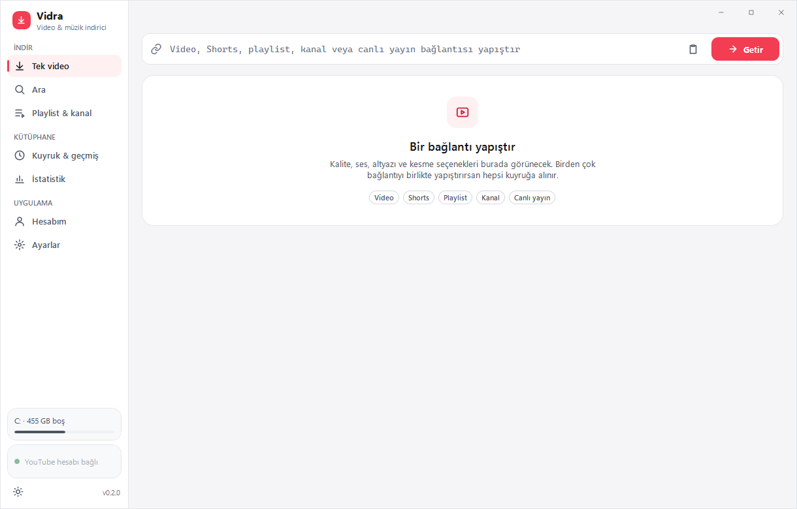
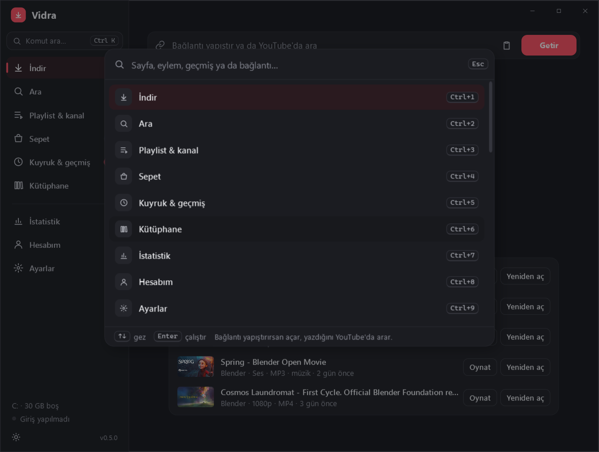
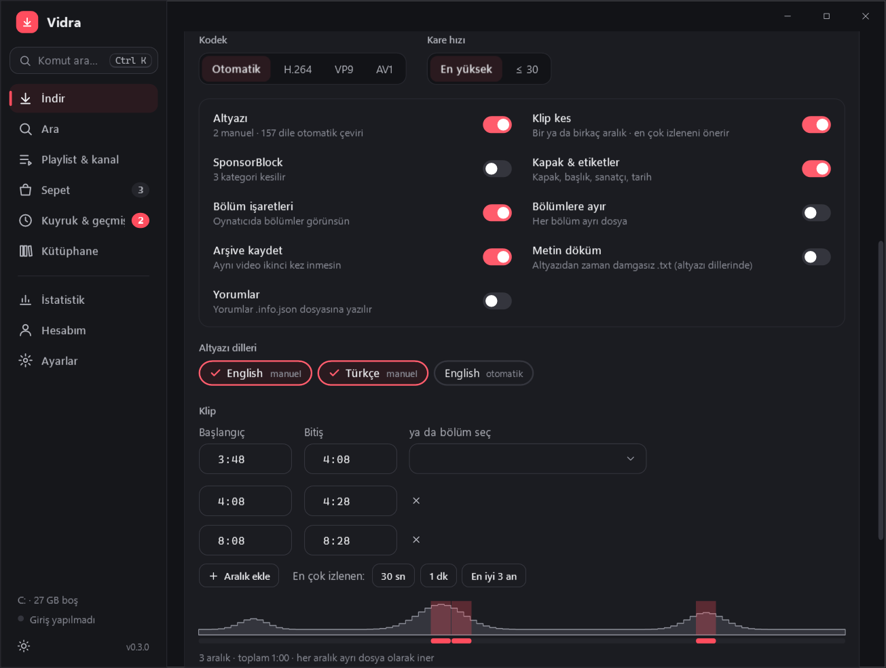
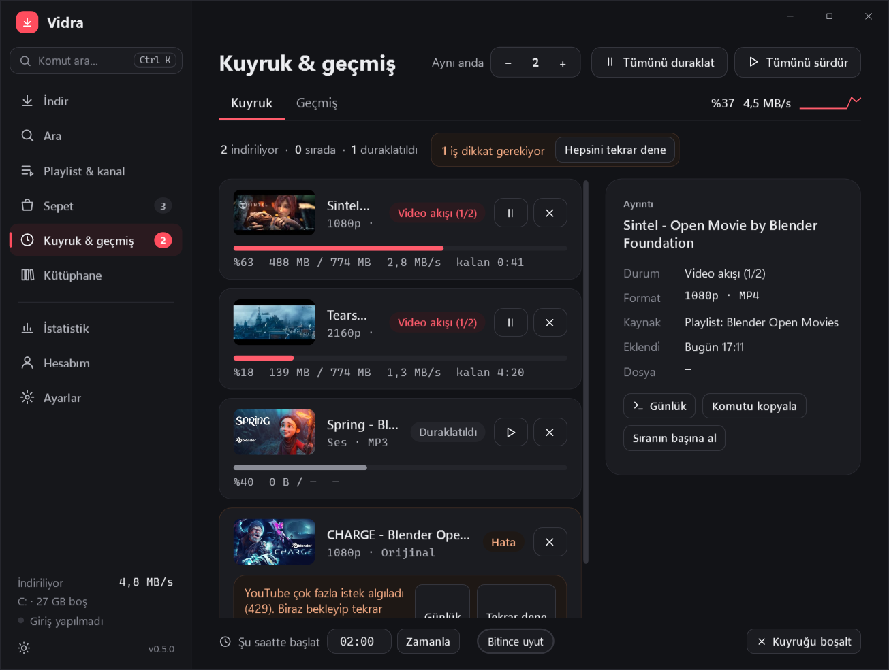
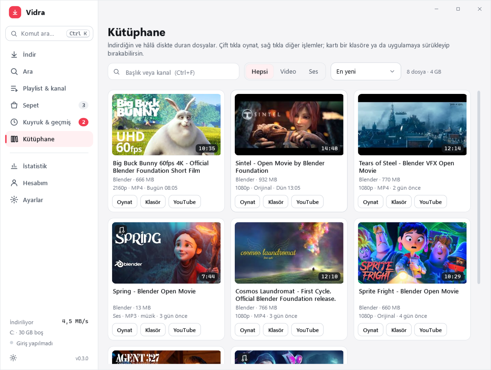

<p align="center"></p>

<h1 align="center">Vidra</h1>

<p align="center">Windows için sade ve hızlı video, playlist, kanal ve müzik indirici. <a href="https://github.com/yt-dlp/yt-dlp">yt-dlp</a> üzerine kurulu.</p>

<p align="center">
  <a href="https://github.com/MihrimatriX/vidra/releases/latest/download/Vidra-Setup.exe"><b>Kurulumu indir</b></a> ·
  <a href="https://github.com/MihrimatriX/vidra/releases/latest/download/Vidra-Portable.exe">Taşınabilir sürüm</a> ·
  <a href="https://mihrimatrix.github.io/vidra/">Web sitesi</a>
</p>



- **Orijinal kalite:** YouTube'daki akışlar dönüştürülmeden kaydedilir; bir seçim yeniden kodlamaya yol açıyorsa (MP3, kesin kesim) ekranda yazar
- **Tek video, Shorts, canlı yayın:** kalite, biçim, kodek, altyazı, klip kesme, SponsorBlock
- **Playlist ve kanal:** Videolar / Shorts / Canlı / Playlistler / Üyeler sekmeleri, filtreler, seçerek indirme
- **Üyelere özel içerik:** üye olduğun kanalların üyelere özel videoları ve playlistleri
- **Müzik modu:** MP3/FLAC, kare kapak, ses eşitleme, sanatçı/albüm/parça etiketleri
- **Kuyruk ve geçmiş:** eşzamanlı indirme, duraklat/sürdür, bitince uyut, **zamanlanmış başlangıç**, istatistikler
- **Video kartları:** playlist, kanal, arama ve kütüphanede kart ızgarası; her kartta **YouTube'da aç**, kanal adına tıklayınca kanal uygulamada açılır
- **Sepet ve çoklu liste:** birden çok playlisti tek seferde seç; farklı playlist, kanal ve aramalardan videoları sepette topla, biçimi bir kez seçip hepsini indir
- **Tarayıcı eklentisi (Chrome/Edge/Brave):** YouTube oturumunu Vidra ile sürekli eşitler, böylece hesaptan atılma biter; YouTube'da sağ tık › "Vidra ile indir"
- **Birden çok hesap:** uygulama içi girişle eklenen hesaplar arasında tek tıkla geçiş
- **Araştırma için:** playlist/kanal listesini Excel'e (CSV) aktar, altyazıdan zaman damgasız metin döküm (.txt), yorumlar (.info.json)
- **Komut paleti (Ctrl+K):** sayfalar, eylemler, hesap akışları ve geçmiş tek kutudan bulanık aranır (`gecmis` → Geçmiş); bağlantı yapıştırınca açar, yazdığını YouTube'da arar
- **Sürükle-bırak:** tarayıcıdan bağlantıyı, masaüstündeki `.url` kısayolunu ya da bağlantı listesi `.txt` dosyasını pencereye bırak; kütüphanedeki kartı da dışarı (klasöre, uygulamaya) sürükleyebilirsin
- **Geri alınabilir işlemler:** geçmişten kaldırma, geçmişi temizleme, sepeti boşaltma, kuyruğu boşaltma alttaki bildirimden **Geri al** ile döner; silinen dosyalar geri dönüşüm kutusuna gider
- **Sağ tık menüleri:** kuyruktaki iş, geçmiş satırı ve kütüphane kartında; görev çubuğunda toplam ilerleme ve duraklat/sürdür düğmeleri
- **Dublaj / ses dili:** çok dilli videolarda istediğin ses izi (YouTube'un otomatik dublajı dahil); yoksa orijinal ses iner
- **En çok izlenen kısım:** YouTube'un "en çok tekrar oynatılan" grafiği klip ekranında; en çok izlenen 30 sn, 1 dk ya da en iyi 3 an tek tıkla klip olur; birden çok aralık, her biri ayrı dosya
- **Canlı yayın ve prömiyer:** başlamamış yayın için "Başlayınca indir", süren yayında "Baştan kaydet"
- **Gizli mod:** geçmişe ve indirme arşivine iz bırakmadan indir (komut paleti ya da kenar çubuğu)
- **Uyumayı engelle:** indirme sürerken ve zamanlanmış başlangıç beklenirken bilgisayar uykuya geçmez
- **Ek yt-dlp argümanları** (ileri düzey) ve **güncelleme denetimi** (yeni Vidra sürümü çıkınca haber verir)

<table>
<tr>
<td><br><sub>Komut paleti (Ctrl+K)</sub></td>
<td><br><sub>En çok izlenen kısım ve çoklu kesim</sub></td>
</tr>
<tr>
<td><br><sub>Kuyruk: toplam ilerleme, toplu işlemler</sub></td>
<td><br><sub>Kütüphane: sıralama, sürükle-bırak</sub></td>
</tr>
</table>

Tüm ekran görüntüleri (açık/koyu): [`docs/screenshots/`](docs/screenshots/)

Windows 10 1809+ / 11 (x64). Kurulum yönetici izni istemez; yt-dlp, ffmpeg ve Deno ilk açılışta otomatik indirilir.
Uygulama imzalı olmadığı için SmartScreen uyarısında **Ek bilgi → Yine de çalıştır** demen gerekebilir.

---

## Geliştirme

.NET 9 + WPF + CommunityToolkit.Mvvm. Tüm yt-dlp mantığı platformdan bağımsız `Vidra.Core` kütüphanesinde;
arayüz `Vidra.App` (WPF) içinde. yt-dlp, ffmpeg/ffprobe ve Deno ilk açılışta uygulamanın kendisi tarafından
`%LOCALAPPDATA%\Vidra\bin` altına indirilir — kullanıcı hiçbir şey kurmaz, yönetici izni gerekmez.

```powershell
dotnet run --project src/Vidra.App            # geliştirme
dotnet test                                    # 171 birim testi (Core)
dotnet publish src/Vidra.App -c Release -r win-x64 -o publish   # tek, bağımsız Vidra.exe (~175 MB)

# Küçük sürüm (.NET 9 Desktop Runtime kurulu makineler için, ~3 MB):
dotnet publish src/Vidra.App -c Release -r win-x64 -p:SelfContained=false -p:PublishReadyToRun=false -o publish-fd

# Sürüm dosyaları → dist/Vidra-Setup.exe + dist/Vidra-Portable.exe (Inno Setup 6 gerekir: winget install JRSoftware.InnoSetup)
pwsh installer/build.ps1
pwsh installer/make-icon.ps1                   # ikonu yeniden üret (renk/şekil değişince)
```

Kurulum yönetici izni istemez (`%LOCALAPPDATA%\Programs\Vidra`), Başlat menüsüne ve isteğe bağlı masaüstüne kısayol
ekler, Ayarlar › Uygulamalar'dan kaldırılabilir. Kaldırınca ayarlar ve geçmiş silinmez; yeni sürüm eskisinin üzerine kurulur.

Geliştirme gereksinimleri: Windows 10 1809+ / 11, .NET 9 SDK, Microsoft Edge WebView2 Runtime (Windows 11'de hazır gelir).

**Ekran görüntüleri:** Debug derlemesinde `Vidra.exe --screenshot-tour <klasör>` örnek verilerle (Blender açık filmleri) ekranları
açık/koyu temada PNG'ye çizer (`Services/ScreenshotTour.cs`, yalnızca Debug). `.github/workflows/screenshots.yml` bunu
`feature/**` dallarında Windows'ta çalıştırıp `docs/screenshots/` altına işler.

## Ekranlar

| Ekran | Neler var |
|---|---|
| **İndir** | Tek kutu: bağlantı yapıştır ya da yaz ve ara (birden çok link → hepsi kuyruğa); boşken **son indirilenler** (oynat ya da farklı kalitede yeniden aç); çok dilli videolarda **ses dili**; canlı yayında **baştan kaydet**, başlamamış yayında **başlayınca indir**. Video / Sadece ses; kalite kartları (boyut, kodek); biçim **Orijinal**/MP4/MKV/WebM; ses Orijinal/MP3/M4A/FLAC/WAV; **dönüştürme satırı** (kopyalanıyor mu, neyin yeniden kodlandığı). "Diğer seçenekler" altında: kodek (H.264/VP9/AV1), ≤30 fps, altyazı dilleri, **klip kesme** (anahtar karede kopyalayarak ya da kesin kesim; **birden çok aralık**, **"en çok tekrar oynatılan" grafiği** ve en çok izlenen kısmı öneren düğmeler), SponsorBlock, bölümler, hazır ayarlar, akış tablosu. |
| **Ara** | YouTube'da arama; sonuçtan tek tıkla analiz, kuyruğa ya da sepete ekleme; YouTube'da aç, kanala git. |
| **Playlist & kanal** | Videolar/Shorts/Canlı/Playlistler/**Üyeler** sekmeleri (sekmeli bağlantı doğrudan o sekmeyi açar); **kart ızgarası** ya da satır listesi (ikisi de sanallaştırılmış, binlerce video); aralık, tarih, süre, arama, "indirilmemiş/üye" filtreleri; süre ve boyut tahmini; **Takip et** (yeni videolar otomatik iner); "Playlistlerim" gibi alt listeleri açma ya da **birden çok listeyi seçip tek seferde indirme**; **Sepete ekle**; görünen listeyi **CSV**'ye aktarma. |
| **Sepet** | Farklı playlist, kanal ve aramalardan toplanan videolar (diskte saklanır); video/ses, kalite ve ses biçimi bir kez seçilir, hepsi birlikte kuyruğa girer. |
| **Kuyruk & geçmiş** | Eşzamanlılık ±, duraklat/sürdür/iptal/tekrar dene, sıranın başına/sonuna al, **hatalıların hepsini tekrar dene**, **kuyruğu boşalt** (geri alınabilir), toplam ilerleme yüzdesi, canlı hız grafiği, seçili işin yt-dlp günlüğü, "komutu kopyala" (çerez yolu maskelenir), **bitince uyut**, **şu saatte başlat** (kapanıştan sonra da geçerli); geçmişte filtre/arama, oynat (çift tık), klasörde göster, tekrar indir, **farklı kalitede indir**, bağlantıyı kopyala, YouTube'da aç, dosyayı geri dönüşüm kutusuna taşı (sağ tık). Bitmemiş işler kapanışta kaydedilir, açılışta duraklatılmış olarak geri gelir. |
| **Kütüphane** | Diskte hâlâ duran indirmeler kart olarak; arama, video/ses filtresi, **sıralama** (yeni/eski/boyut/ad/kanal), çift tıkla oynat, klasörde göster, YouTube'da aç, geri dönüşüm kutusuna taşı; kartı sürükleyip dosyayı başka yere bırak. |
| **İstatistik** | Toplam indirme, boyut ve süre; video/ses dağılımı; bu hafta; son 14 günün grafiği; en çok indirilen kanallar. |
| **Hesabım** | **Tarayıcı eklentisi** (kurulum ve eşitleme durumu); **birden çok hesap** (ekle, adlandır, geç, kaldır); **uygulama içi YouTube girişi** (WebView2), oturum testi, çıkış; hesap akışları: Abonelikler, Daha sonra izle, Beğenilenler, Geçmiş, Playlistlerim; takip edilen listeler ve kontrol aralığı; nazik mod. |
| **Ayarlar** | Çerez kaynağı (Vidra hesabı / Firefox / Chrome / Edge / Brave / cookies.txt), tarayıcı profili; klasör ve dosya adı şablonları (önizlemeli); format varsayılanları; -N/-R/hız sınırı/proxy, **ek yt-dlp argümanları** (Vidra'nın yönettiği bayraklar reddedilir); tema (açık/koyu/sistem), pano izleme, bildirimler, tepsi, **uyumayı engelle**, **güncelleme denetimi**; bileşen sürümleri, yt-dlp güncellemesi (kararlı/nightly), yeniden indirme. |

Ayrıca: sistem tepsisi + baloncuk bildirimleri (tepsi ipucunda canlı kuyruk durumu), pano izleme (yoklamasız, `AddClipboardFormatListener`), tek örnek (ikinci açılış bağlantıyı mevcut pencereye iletir: `Vidra.exe <url>`), koyu başlık çubuğu, pencere konumu ve boyutu hatırlanır.

### Klavye kısayolları

| Kısayol | İş |
|---|---|
| `Ctrl+K` | Komut paleti (↑↓ gez, Enter çalıştır, Esc kapat) |
| `Ctrl+1` … `Ctrl+9` | İndir, Ara, Playlist & kanal, Sepet, Kuyruk, Kütüphane, İstatistik, Hesabım, Ayarlar (`Ctrl+,` de Ayarlar) |
| `Ctrl+L` | İndir ekranındaki bağlantı kutusuna git |
| `Ctrl+F` | Bu ekrandaki arama kutusuna git (yoksa komut paleti) |
| `Ctrl+V` | Metin kutusu dışındayken: panodaki bağlantıyı hangi ekrandan olursa olsun aç |

## Mimari

```
src/Vidra.Core/                      (net9.0 — Windows'a bağımlı değil, Linux'ta test edilir)
  Models/        DownloadOptions (değişmez record), AppSettings, CookieSource (JSON polimorfik), DownloadJob (gözlemlenebilir), HistoryEntry
  YtDlp/         YtDlpArgs (saf: ayar → argüman listesi), ExtraArgs (ek argüman doğrulama), OutputParser, ProbeParser (-J → model), YtDlpService, YouTubeUrl, Templates
  Process/       IProcessRunner + ProcessRunner (ArgumentList, UTF-8, süreç ağacını öldürme)
  Queue/         DownloadQueue (eşzamanlılık, duraklat = öldür + .part'tan devam, geçmiş, bekleyen işler), QueueProgress (toplam ilerleme)
  Follow/        FollowService (takip edilen listeleri aralıkla kontrol, arşivle karşılaştır)
  Auth/          NetscapeCookies (cookies.txt yazıcı, oturum algılama)
  Browser/       BrowserBridge (eklentiyle native messaging: çerçeveleme, çerez listesi → cookies.txt)
  Export.cs      Playlist → CSV (formül enjeksiyonuna karşı), WebVTT → düz metin döküm
  Fuzzy.cs       Komut paleti için Türkçe harf duyarsız bulanık eşleştirme
  Heatmap.cs     "En çok tekrar oynatılan" grafiğinden en iyi, çakışmayan klip pencereleri
  AppUpdate.cs   GitHub releases/latest → yeni sürüm var mı
  Tools/         ToolManager (bileşenleri indir/güncelle/sürüm oku)
  Storage/       AppPaths, JsonStore (atomik yazma), SettingsStore (debounce), ArchiveStore
src/Vidra.App/                       (net9.0-windows — WPF)
  Themes/        Light/Dark paletleri (DynamicResource), Styles (tüm kontrol şablonları), Icons (çizgi ikon geometrileri)
  Views/         DownloadView, SearchView, PlaylistView, QueueView, StatsView, AccountView, SettingsView, LoginWindow (WebView2)
  ViewModels/    her ekran için bir VM (CommunityToolkit.Mvvm kaynak üreticileri)
  Services/      ThemeService, AccountService, ClipboardWatcher, TrayService, PowerService, LinkDrop (sürükle-bırak)
tests/Vidra.Core.Tests/              xUnit: argümanlar, ayrıştırma, probe, çerezler, kuyruk (sahte süreç), depolama, canlı yt-dlp (isteğe bağlı)
```

**Neden bu ayrım?** yt-dlp entegrasyonunun %90'ı saf fonksiyon: argüman üretimi, çıktı ayrıştırma, JSON eşleme.
Bunlar Core'da olduğu için UI olmadan, hızlı ve deterministik test edilir. Kuyruk `IProcessRunner` üzerinden
sahte bir yt-dlp ile test edilir. Canlı test için: `VIDRA_BIN_DIR=<yt-dlp/ffmpeg/deno klasörü> dotnet test`.

**İlerleme takibi:** yt-dlp'nin insan okunur çıktısını regex'le kazımak yerine `--progress-template` ile makine okunur
satırlar (`VIDRA:dl|…`) basılır; bitmiş dosya yolu `--print after_move:` ile alınır.

**Kalite seçimi:** `-f bv*+ba/b -S res:1080,fps:30,vcodec:h264,acodec:m4a` — sıralama, `-f "bv[height<=1080]"`
filtrelerinden dayanıklıdır. yt-dlp `-S` alanlarını kendi varsayılan sıralamasının *önüne* koyar; bu yüzden "En iyi"
seçiliyken de `res` en başa yazılır, yoksa kodek tercihi çözünürlüğü ezer (4K varken 1080p H.264 iner).

**Dönüştürme:** video ve ses her zaman kopyalanarak birleştirilir. **Orijinal** biçimde kodek ve kap zorlanmaz
(`--merge-output-format` yok): VP9/AV1 + Opus → WebM (kapak gömülecekse MKV), H.264 + AAC → MP4. Yeniden kodlama
yalnızca şu durumlarda olur ve indirme ekranında yazar: ses MP3/FLAC/WAV'a dönüştürülürken ve klipte **kesin kesim**
(`--force-keyframes-at-cuts`) açıkken. M4A/Opus seçilince o kodekteki akış seçildiği için ses kopyalanır.

## YouTube girişi nasıl çalışır

1. Hesabım → "YouTube'a giriş yap" ayrı bir WebView2 profili (`%LOCALAPPDATA%\Vidra\WebLogin`) ile Google giriş sayfasını açar.
2. youtube.com'a dönüldüğünde `SAPISID`/`SID` çerezleri varsa `CookieManager.GetCookiesAsync` ile okunur ve
   `%LOCALAPPDATA%\Vidra\youtube-cookies.txt` (Netscape biçimi) yazılır; yt-dlp'ye `--cookies` ile verilir.
3. Oturum tarayıcından **ayrı** olduğu için YouTube'un tarayıcıda yaptığı çerez yenilemesi onu geçersiz kılmaz.
4. Google gömülü tarayıcıda girişi reddederse ("Bu tarayıcı güvenli olmayabilir") pencere "Tarayıcıdan al" seçeneği sunar.
5. Çıkış: çerez dosyası ve WebView2 profil klasörü silinir.

## Bilinen sınırlar ve notlar

- **Bot doğrulaması / 429:** veri merkezi ve VPN IP'lerinde YouTube "Sign in to confirm you're not a bot" der; uygulama
  bunu ayrı bir hata türü olarak gösterir ve girişe yönlendirir. Ev bağlantısında genelde sorun olmaz.
- **Hesap riski:** yt-dlp ekibi, çerezle yoğun indirmenin hesabın/IP'nin işaretlenmesine yol açabileceği konusunda uyarıyor.
  Nazik mod (varsayılan açık) oturumla istekler arasına bekleme ekler; mümkünse ikincil bir hesap kullan.
- **Chromium tarayıcı çerezleri:** Windows'ta Chrome/Edge açıkken çerez veritabanını kilitleyebilir; Firefox ya da uygulama içi giriş daha güvenilir.
- `Playlistlerim` (`feed/playlists`) akışının yt-dlp desteği sürüme göre değişebilir; boş dönerse yt-dlp'yi güncelle.
- **Üyeler sekmesi:** yt-dlp kanalın `/membership` sekmesini okuyamadığı için Vidra kanal kimliğinden (`UC…`) üyelere özel
  listeyi (`UUMO…`) açar; bunun için kanalın videolar sekmesine bir ek sorgu yapılır.
- Yalnızca indirme hakkına sahip olduğun içerikleri indir; YouTube Kullanım Şartları geçerlidir.
